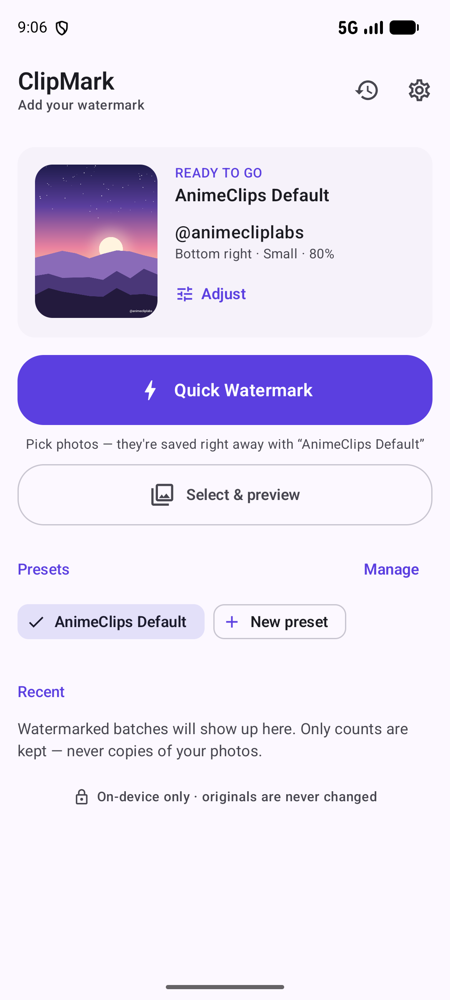
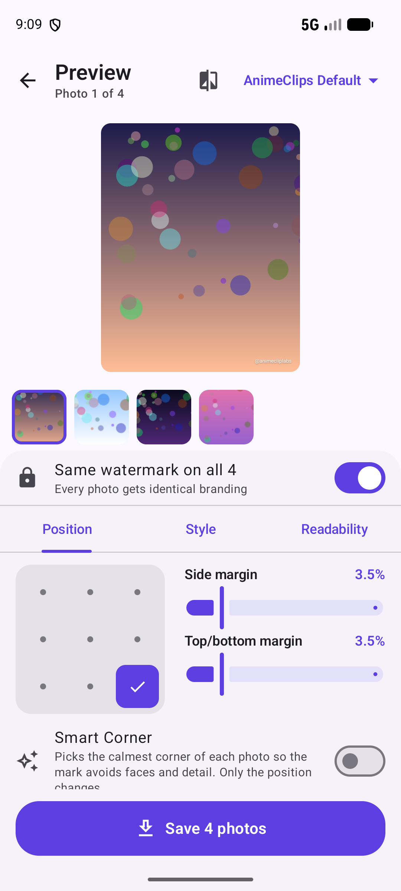
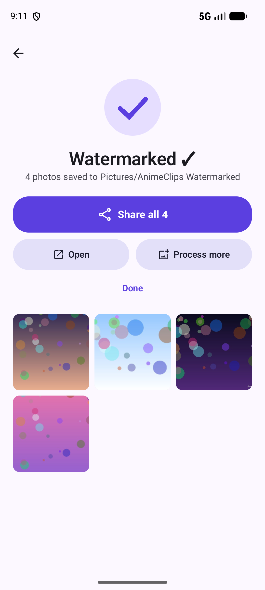
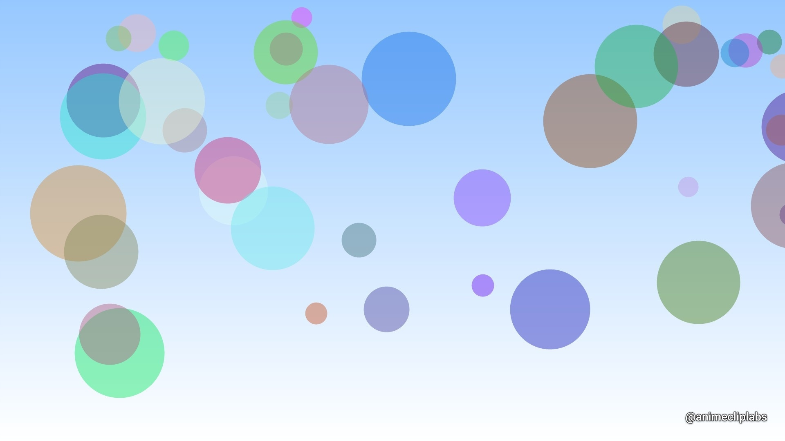

# ClipMark — subtle watermarks for @animecliplabs

A small, offline Android app that adds a subtle creator watermark (default **`@animecliplabs`**,
bottom-right, small, white, 80 % opacity, soft shadow) to one photo or a hundred, and saves new
copies to the gallery. Originals are never modified.

* **Quick Watermark**: pick photos, and they're saved with your preset. No other steps.
* **Select & preview**: live preview you can drag, with snapping, press-and-hold to compare with the original, and per-photo adjustments.
* **Share target**: Gallery → Share → *Watermark with ClipMark*.
* **Batch**: sequential background processing with progress, cancel, and resume after a crash. One bad file never stops the rest.
* **Presets**: several named presets; the last used one is always ready when you reopen the app.
* **Smart Corner** (optional) picks the calmest corner per photo. **Contrast Assist** adds a shadow or outline only where the text would disappear.
* **Output**: saved to `Pictures/AnimeClips Watermarked/`, at the original resolution and aspect ratio, in the original format where possible, with duplicate-safe names (`x_watermarked.jpg`, `x_watermarked_2.jpg`, …).
* **After saving**: *Share all* (for an Instagram carousel), *Open*, *Process more*.
* **History**: per-day counts, with links to the exports. No image copies are stored.

See [docs/DESIGN.md](docs/DESIGN.md) for the product reasoning, feature choices and risk analysis.
All engineering documentation (requirements, architecture, data storage, testing, deployment, decisions) is indexed in
[docs/DOCUMENTATION_INDEX.md](docs/DOCUMENTATION_INDEX.md).

| Home | Editor | Saved |
|---|---|---|
|  |  |  |

Real export (1920×1080, unchanged size). On the near-white corner, Contrast Assist added the outline automatically:


`samples/` contains the generated test images used during device testing (4 sizes and aspect ratios, JPEG + PNG).

---

## Architecture

```
app/src/main/java/com/animecliplabs/clipmark/
├── core/            Pure Kotlin — no Android imports, unit-tested on the JVM
│   ├── model/       WatermarkStyle, Anchor, Preset, OutputSettings
│   ├── layout/      WatermarkLayout (placement + safe area), Snapping (drag/snap)
│   ├── analysis/    ColorMath, ReadabilityResolver (Contrast Assist), SmartCorner, RegionStats
│   ├── naming/      FileNamer (duplicate-safe names)
│   ├── format/      OutputFormatResolver
│   ├── metadata/    MetadataPolicy (which EXIF tags are copied)
│   └── batch/       BatchJob model, BatchRunner (sequential, resumable), History grouping
├── image/           Android adapters: ImageLoader (ImageDecoder), WatermarkRenderer (Canvas),
│                    WatermarkAnalyzer, ExifCopier, MediaStoreOutputStore, WatermarkProcessor
├── data/            PresetRepository / SettingsRepository / HistoryRepository (DataStore + JSON),
│                    BatchJobStore (atomic JSON file), BatchRepository (WorkManager)
├── work/            BatchWorker (foreground CoroutineWorker), BatchNotifications
└── ui/              Compose + Material 3: home, editor, batch, presets, history, settings, common
```

Data flows one way: **UI → ViewModel (StateFlow) → repositories/use of `core` → image pipeline → storage**.
A small hand-written `AppContainer` wires everything together. The app is too small for Hilt or
Room to pay for themselves.

## How watermark rendering works

* **Relative units.** Text size is a percentage of the image's **short edge** (Small = 2.6 %), and
  so are the horizontal and vertical margins (3.5 % by default). The same preset gives visually
  identical branding on 1080×1350, 1920×1080 and 4000×3000 images.
* **Placement** (`WatermarkLayout`): the watermark box is the text plus constant padding (20 % of
  text size), which leaves room for the shadow or outline. The box is positioned by one of 9
  anchors, or by a dragged centre, and then **clamped inside the safe area**, so it can never
  touch or cross an edge. On tiny images the text shrinks to fit rather than overflow.
* **Drawing** (`WatermarkRenderer`): the text is drawn into a `saveLayer` bounded to the watermark,
  with the chosen opacity applied to the whole layer. Fill, outline and shadow fade together
  instead of stacking. Fonts are Android system families, so they add no APK weight and resolve
  identically in preview and export.
* **Preview = export.** The editor draws with the *same renderer* on the display-sized surface.
  Because layout is relative, the preview is an exact scaled rendition of the saved file. Smart
  Corner decisions shown in the preview are carried into the batch job, so the export matches.
* **Snapping**: while dragging, the box snaps to any of the 9 positions within about 22 dp, and to the
  centre lines otherwise. You get a haptic tick, and the safe area is drawn as a dashed guide.
* **Contrast Assist**: samples the mean luminance under the watermark. If the WCAG contrast ratio
  with the text colour is below 3:1 it adds a soft shadow, and below 1.6:1 an outline, in the
  opposite colour (dark for light text, light for dark text). The text colour itself never
  changes.
* **Smart Corner**: for each corner it samples texture (standard deviation), edges and contrast.
  It moves the watermark away from your preferred corner only when another corner is clearly
  better. Contrast counts only up to WCAG AA (4.5:1), so a "slightly darker" corner is not a
  reason to move.

## How images are processed

For each image, one at a time:

1. **Decode** with `ImageDecoder` into a mutable software bitmap at **full resolution**. ImageDecoder
   applies EXIF orientation, so pixels are upright, exactly as galleries show them.
2. **Analyse** (read-only) for Smart Corner and Contrast Assist.
3. **Draw** the watermark directly on the decoded pixels. Nothing else is touched: no filters, no
   colour conversion, no resizing, no cropping. The colour space of the source is kept.
4. **Encode** to a private temp file:
   * JPEG → JPEG at quality **95** (or 100 in Settings). Re-encoding JPEG is unavoidable; 95 is
     visually lossless.
   * PNG → PNG (lossless).
   * WebP → WebP (lossy, same quality setting).
   * HEIC/AVIF → JPEG, and GIF/BMP → PNG, because Android has no general encoder for those.
   * Anything with transparency → PNG, so alpha is never flattened to black.
5. **Metadata**: copy the whitelisted EXIF tags, write Orientation = normal, and set the real dimensions.
   If the original has none of the whitelisted tags (typical for screenshots), no EXIF block is written at all.
6. **Publish** via MediaStore to `Pictures/AnimeClips Watermarked/` with `IS_PENDING` (no
   half-written files in the gallery), under a unique name.
7. Recycle the bitmap and delete the temp file before the next image.

**Memory:** the preview uses a ≤2048 px decode. Export decodes at full size within a budget of about 35 %
of currently available RAM (at most 512 MB, i.e. ~134 MP). Only if an image exceeds that, or an
`OutOfMemoryError` occurs, is it decoded smaller. The result screen then says so explicitly.
Batches never hold more than one full-resolution image at once.

## How metadata is handled

| Kept (default) | Dropped | Written fresh |
|---|---|---|
| Capture dates and time zones (`DateTimeOriginal`, `OffsetTime*`, `SubSec*`), camera make/model, lens, exposure, ISO, focal length, flash, white balance, artist, copyright | GPS location (unless you turn off "Remove location"), embedded thumbnail, maker notes, XMP | `Orientation = 1` (pixels are already upright), `PixelXDimension`/`PixelYDimension` |

Limitations:
* Orientation is normalised rather than preserved: the pixels are rotated upright and the tag
  says "normal". Every viewer shows the image the same way; only the raw pixel matrix of a
  rotated JPEG differs from the original.
* XMP and IPTC blocks are not carried over. The colour profile is kept, because the decoded
  bitmap keeps its colour space and the encoder embeds it.
* Galleries that sort by capture date will place a watermarked copy of an old photo next to the
  original, not at the top. Turn off "Keep camera info & dates" if you'd rather have exports
  sorted by when they were made.
* If metadata cannot be written, the image is still saved and the result screen notes it.

## How batch processing works

* Starting a batch writes a **job file** (`files/batch/current_batch.json`) listing every photo
  and its style, then enqueues a unique **WorkManager** job (expedited, falling back to normal).
* `BatchWorker` runs as a **foreground service** (type `mediaProcessing` on Android 15+,
  `dataSync` before that). It shows "Watermarking 7 of 20" with a Cancel action, so it keeps
  going while you switch apps.
* `BatchRunner` processes images **sequentially** and saves the job file **after every image**.
  * One image failing (corrupted, unsupported, deleted, access expired, too large) only marks that image.
  * **Storage full** stops the batch; the remaining images are marked *skipped* and can be retried.
  * **Cancel** keeps everything already saved.
  * **Process death / system stop** leaves the job unfinished. WorkManager restarts it and done
    images are skipped. If it can't restart, Home shows *Batch paused — Resume*.
* Photo-picker access is persisted for the duration of a batch (so it can resume after the app is
  killed) and released when the batch finishes.
* "Retry" re-runs only what didn't save.

## Build

Requirements: JDK 17+ (Android Studio's bundled JBR works), Android SDK platform 37 and build-tools 36.0.0.

```bash
./gradlew assembleDebug          # app/build/outputs/apk/debug/app-debug.apk
./gradlew assembleRelease        # minified; signed with the local debug key for sideloading
./gradlew testDebugUnitTest      # JVM unit tests
./gradlew connectedDebugAndroidTest   # on-device pipeline tests (emulator or phone)
```

Or open the folder in Android Studio and press Run.

Toolchain: AGP 9.4.1 (built-in Kotlin), Gradle 9.8.0, Kotlin 2.4.20, Compose BOM 2026.09.00,
Material 3 1.4, WorkManager 2.12, DataStore 1.2, ExifInterface 1.4.

**Release signing:** release builds are signed with the debug key so the APK installs directly
on your own phone. Configure your own `signingConfig` before distributing anywhere.

### Build environment used for this project (non-system drive)

| What | Where |
|---|---|
| Project | `F:\ClaudeProject\WatermarkTool` |
| Android SDK (platform 37, build-tools 36.0.0, platform-tools only) | `D:\Android\Sdk` (`ANDROID_HOME`, user-level) |
| Gradle home: wrapper, dependency and build caches | `D:\Android\Gradle` (`GRADLE_USER_HOME`, user-level) |
| JDK | Android Studio's JBR at `E:\AndroidStudio\jbr` (`JAVA_HOME`, user-level) |

`local.properties` points `sdk.dir` at `D:\Android\Sdk`. The pre-existing SDK and AVD under
`%LOCALAPPDATA%\Android` were left untouched. Instrumented tests reused the existing Pixel_8 AVD
with `-no-snapshot-save`, so no new emulator image was downloaded.

## Minimum Android version

**Android 10 (API 29)**. Targets and compiles against **API 37**.
API 29 is the floor that allows saving to the shared gallery through MediaStore
(`RELATIVE_PATH` and `IS_PENDING`) **without any storage permission**, and it provides `ImageDecoder`
and `ContentResolver.loadThumbnail`. That covers the vast majority of phones in use.

## Permissions

| Permission | Why | When |
|---|---|---|
| *(none for photos)* | The system Photo Picker grants per-photo read access; MediaStore writes need no permission on Android 10+ | — |
| `POST_NOTIFICATIONS` (Android 13+) | Progress and "batch finished" notifications | Asked **once**, when you start your first batch. Declining is fine: batches still run. |
| `FOREGROUND_SERVICE`, `…_MEDIA_PROCESSING`, `…_DATA_SYNC` | Keep a batch running while you use other apps | Install-time, no prompt |
| `WAKE_LOCK`, `RECEIVE_BOOT_COMPLETED`, `ACCESS_NETWORK_STATE` *(added by WorkManager's library manifest, not declared by the app)* | WorkManager keeps work running and reschedules it after a reboot. The network-state permission only lets it *check* connectivity; it grants no network access. | Install-time, no prompt |

No internet permission is declared. The app cannot upload anything. There are no accounts, no
analytics and no tracking.

## Known limitations

* **Animated GIF/WebP** become a still image (first frame), saved as PNG or WebP.
* **HEIC/AVIF** originals are saved as **JPEG** (quality 95/100), because Android can't encode them.
* **Ultra HDR JPEGs**: the gain map travels with the decoded bitmap; the watermark is drawn on the
  SDR base image. On HDR displays the watermark may look slightly brighter or dimmer than intended.
* **JPEG/WebP re-encoding** is unavoidable, since pixels changed where the watermark sits. PNG is
  lossless, and pixels outside the watermark are verified bit-identical for PNG in the tests.
* **Extremely large images** (roughly above 100 MP on low-RAM phones) are saved at a reduced
  size, and the result screen tells you when this happened.
* **File names with the Photo Picker:** the system Photo Picker hides real file names from apps
  without media permission; it reports its own item ID, such as `41.jpg`. Rather than produce
  meaningless `41_watermarked.jpg` names or ask for a gallery-wide permission, exports from the
  picker are named `animecliplabs_<date>_<time>_watermarked.<ext>`. Photos shared in from the
  gallery's share sheet usually keep their real names (`sunset_watermarked.jpg`).
* **Photos shared in from other apps** can't always be resumed after the app is killed, because
  some apps' grants can't be persisted. They then fail with "access expired — select it again".
* A dragged ("custom") position is stored as a fraction of the image, so on photos with very
  different aspect ratios it lands in proportionally the same place. Use the 9 positions when
  you need pixel-consistent margins across mixed aspect ratios.
* Fonts are limited to Android's built-in families.

## Testing strategy

**JVM unit tests** (`app/src/test`, 63 tests), which cover all the decision-making logic:
* `WatermarkLayoutTest`: default bottom-right placement exactly on the margins; every anchor inside the
  safe area on six aspect ratios; resolution scaling (1080 vs 4320 identical relative
  placement); preview-size vs export-size parity; clamping of dragged positions; shrink-to-fit
  on tiny images; effects never move the box; coercion of out-of-range values.
* `SnappingTest`: snapping to quick positions, centre-line snapping, and dragging turns Smart Corner off.
* `FileNamerTest`: `_watermarked`, `_2`, `_3`…, extension follows the output format, unsafe characters, fallbacks, truncation, and opaque photo-picker IDs.
* `OutputFormatResolverTest`: format mapping, transparency safety.
* `PresetCodecTest`: the default preset matches the brief; round-trips; old and new schema tolerance; corrupt storage → default; batch job serialization.
* `AnalysisTest`: WCAG maths, Smart Corner choices (busy vs calm, contrast, hysteresis), and Contrast Assist in both directions.
* `BatchRunnerTest`: 15 photos with one bad → 14 saved; per-image persistence; exceptions isolated; resume skips done items; name reservation; storage-full stop; user cancel vs system stop.
* `HistoryAndMetadataTest`: day grouping and caps; metadata whitelist and location stripping.

**Instrumented tests** (`app/src/androidTest`, 13 tests, run on the Pixel_8 API 37 emulator). These use
generated sample images, so no binary test assets are needed:
* JPEG keeps full 4000×3000 resolution and format; WebP stays WebP.
* The **original file is byte-identical** after processing.
* **PNG pixels outside the watermark are bit-identical** to the original, and pixels inside actually change.
* An EXIF "rotate 90" JPEG is exported upright (300×400) with Orientation = normal. Date and camera
  are copied; GPS is stripped by default and kept only when allowed.
* Transparency is preserved even when JPEG output is forced.
* Corrupted and truncated files fail gracefully; a missing file → "not found".
* A batch with a bad file in the middle saves the others.
* Same-named originals from different folders, plus an existing output, → `_2`, `_3`, and nothing is overwritten.
* Huge images are reduced only under a memory budget, keeping the aspect ratio.
* Real **MediaStore** save into `Pictures/AnimeClips Watermarked/` with duplicate-safe naming (test files are cleaned up).
