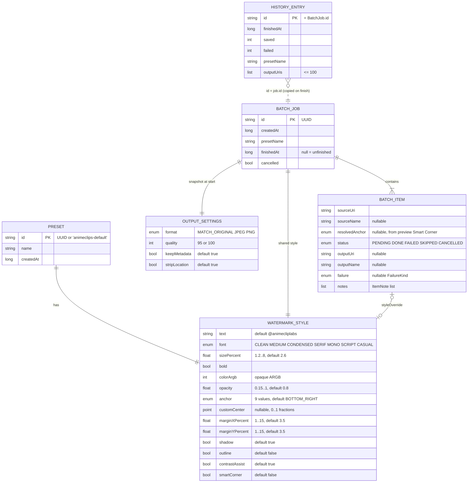

# Data Storage — ClipMark

ClipMark has **no database** (no SQLite/Room). All app state is small JSON stored in a DataStore
Preferences file and one job file. This document is the reference for those formats. Changing
them affects backward compatibility with data already on users' phones.

Source of truth: `data/Repositories.kt`, `data/Codecs.kt`, `data/BatchJobStore.kt`, `core/model/`, `core/batch/`.

## 1. Locations

| Store | Path (app-private) | Backed up? |
|---|---|---|
| DataStore `clipmark` | `files/datastore/clipmark.preferences_pb` | Yes: cloud backup and device transfer (`res/xml/data_extraction_rules.xml`, `backup_rules.xml`) |
| Batch job | `files/batch/current_batch.json` (+ `.tmp` during a write) | No |
| Encode temp | `cache/export/` | No |
| Exports | Shared storage `Pictures/AnimeClips Watermarked/` via MediaStore | Owned by the user's gallery, not the app |

## 2. DataStore keys

| Key | Type | Content | Written by |
|---|---|---|---|
| `presets` | String (JSON) | `List<Preset>` | `PresetRepository` |
| `active_preset` | String | Preset `id` | `PresetRepository.setActive/create` |
| `output_settings` | String (JSON) | `OutputSettings` | `SettingsRepository.update` |
| `history` | String (JSON) | `List<HistoryEntry>`, newest first, ≤ 60 | `HistoryRepository.record` |
| `asked_notifications` | Boolean | Whether POST_NOTIFICATIONS was already requested | `SettingsRepository.markAskedForNotifications` |

## 3. Entity model

The `opacity` range is enforced by the editor slider (`MIN_OPACITY`). The renderer only clamps opacity to 0..1.
Size and margin ranges are enforced by `WatermarkLayout` at draw time.

Enums: `FailureKind` = `UNREADABLE, UNSUPPORTED, ACCESS_LOST, NOT_FOUND, TOO_LARGE, STORAGE_FULL, WRITE_FAILED, UNKNOWN`.
`ItemNote` = `DOWNSCALED_FOR_MEMORY, METADATA_NOT_COPIED, SHRUNK_TO_FIT`.

## 4. Serialization rules (compatibility contract)

`AppJson` (`data/Codecs.kt`) is configured with:

* `ignoreUnknownKeys = true`: data from a newer app version loads.
* `coerceInputValues = true`: unknown enum values and invalid nulls fall back to the property default.
* `encodeDefaults = true`: every field is written, so older versions see explicit values.

Decode failures never throw to the caller:

* Presets → `[Preset.Default]` if the value is missing, corrupt or empty.
* Settings → `OutputSettings()`.
* History → empty list.
* Batch job → `null` (treated as "no batch").

**When changing a model:** add new fields *with defaults*, and never rename or remove a serialized
property or enum constant without a migration. `PresetCodecTest` covers the old-schema and new-schema
cases and should be extended with the change.

## 5. Lifecycle

| Data | Created | Updated | Deleted |
|---|---|---|---|
| Preset | Default is synthesised on first read. User-created ones via Editor. | Update / rename / duplicate | Delete (never the last one) |
| Output settings | First change in Settings | Settings screen | Never |
| Batch job | `BatchRepository.start` / `retryUnsaved` (replaces the previous one) | After every image | `dismiss()` when not running |
| History entry | Worker wrap-up, if saved + failed > 0 | Never | Oldest dropped beyond 60; "Clear history" |
| Persisted URI grants | Batch start (best effort) | — | Worker wrap-up (`releaseReadAccess`) |
| Temp files | Per image | — | After each image; all of them at worker start |

History stores only content URIs of exports. If the user deletes an export, its link stops
resolving, and `HistoryViewModel.existingOutputs` filters it out before sharing.
