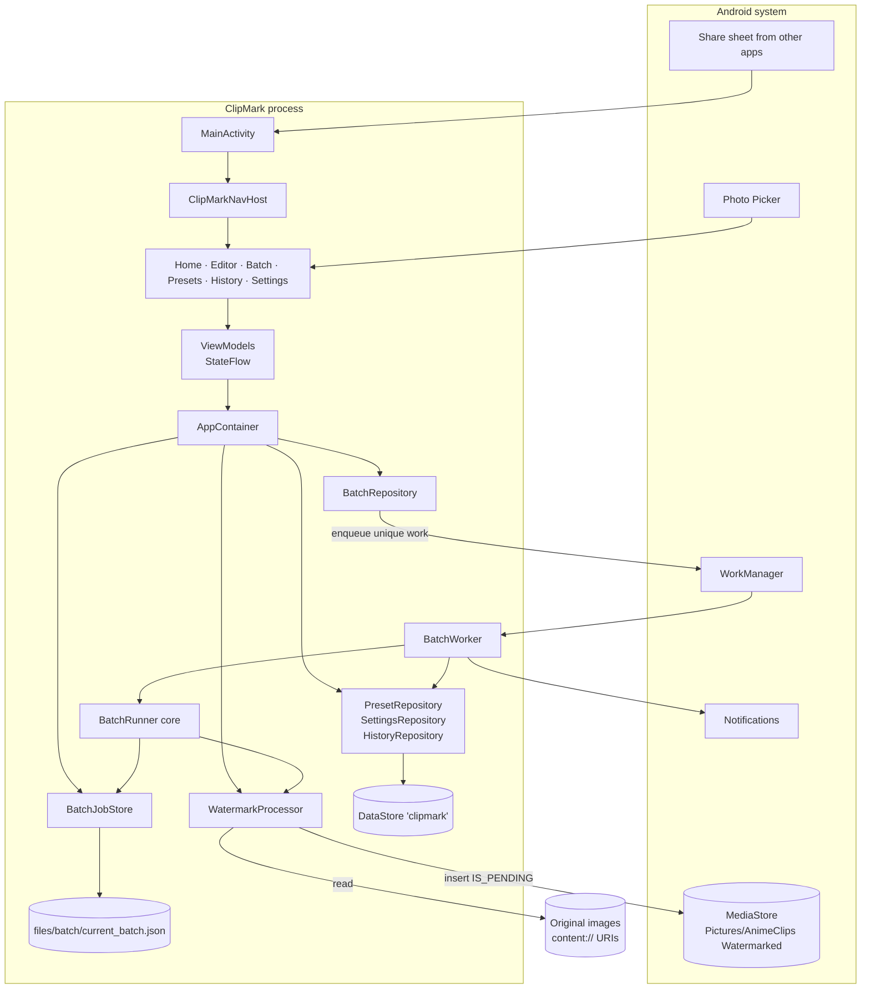
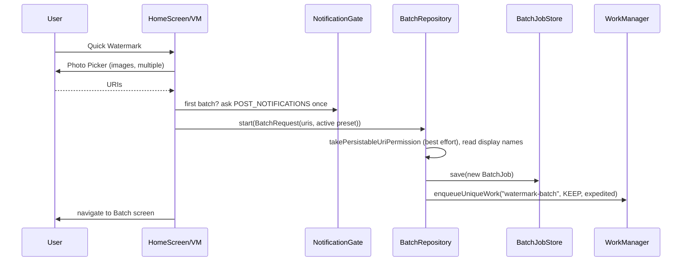
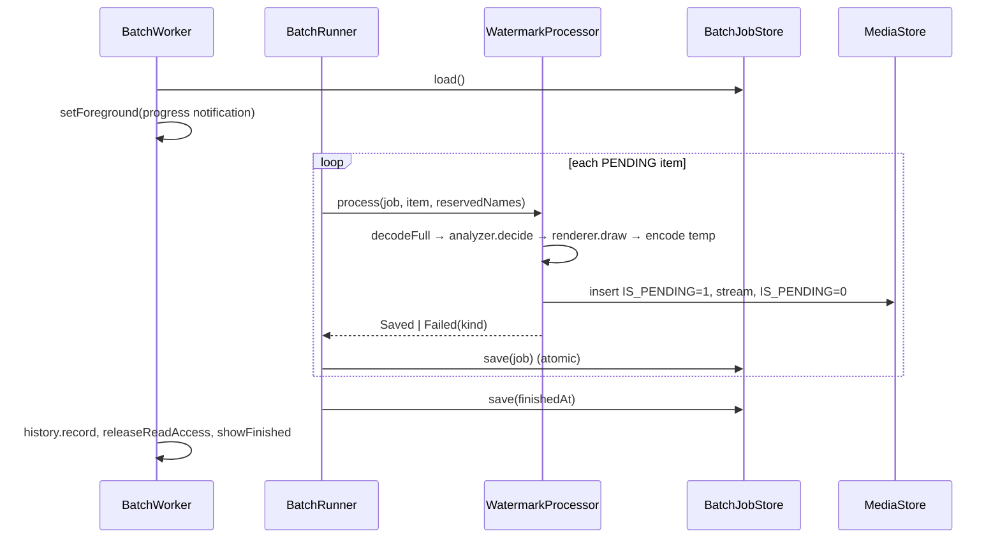
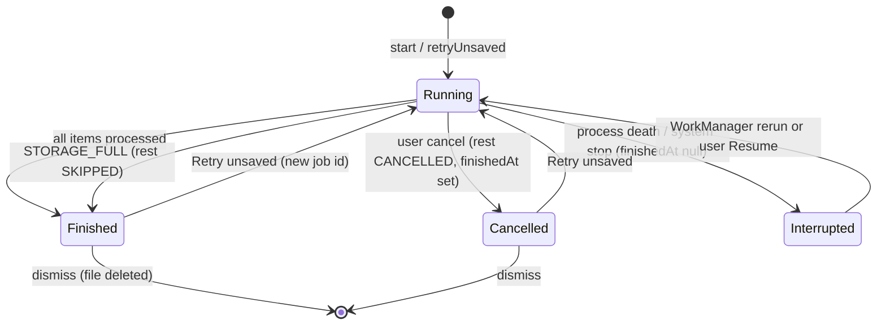

# System Architecture — ClipMark

This is the component-level view of the app. The README gives the user-facing explanation of
[rendering](../../README.md#how-watermark-rendering-works), [image processing](../../README.md#how-images-are-processed)
and [batching](../../README.md#how-batch-processing-works). This document covers structure, responsibilities
and data flow. Persisted formats are in [DATA_STORAGE.md](DATA_STORAGE.md).

## 1. Runtime shape

* **One process, one Activity** (`MainActivity`, `singleTop`) hosting a Compose `NavHost`.
* **One background worker** (`BatchWorker`, a WorkManager `CoroutineWorker`) that runs as a
  foreground service while a batch runs.
* **No server, no network, no database engine, no DI framework.** `ClipMarkApplication` builds a
  hand-written `AppContainer` in `onCreate`. Screens obtain it through `LocalAppContainer`, and
  ViewModels receive it through `containerViewModel { … }`.

## 2. Layers

Dependencies point downward only. `core` has no Android imports (enforced by convention, not
by a separate Gradle module).

| Layer | Package | Responsibility |
|---|---|---|
| UI | `ui/` | Compose + Material 3 screens and ViewModels. `ClipMarkNavHost` defines type-safe `@Serializable` routes. |
| Data | `data/` | Persistence and orchestration: DataStore-backed repositories, the batch job file, and WorkManager enqueueing. |
| Work | `work/` | `BatchWorker` (foreground execution) and `BatchNotifications` (channels, progress/finish notifications). |
| Image | `image/` | Android adapters: decode (`ImageLoader`), draw (`WatermarkRenderer`), analyse (`WatermarkAnalyzer`), EXIF (`ExifCopier`), publish (`MediaStoreOutputStore`), and the per-image pipeline (`WatermarkProcessor`). |
| Core | `core/` | Pure Kotlin decisions: models, layout, snapping, Smart Corner, Contrast Assist, naming, format selection, metadata policy, batch loop, history grouping. |

### Core seams (interfaces implemented by Android code)

| Interface | Declared in | Implemented by | Test double |
|---|---|---|---|
| `TextMeasurer` | `core/layout/WatermarkLayout.kt` | `WatermarkRenderer.measurer` (uses `Paint`) | `FakeMeasurer` (`app/src/test/.../TestSupport.kt`) |
| `ItemProcessor` | `core/batch/BatchRunner.kt` | `WatermarkProcessor` | Lambdas in `BatchRunnerTest` |
| `JobSink` | `core/batch/BatchRunner.kt` | `BatchJobStore` | Lambdas in `BatchRunnerTest` |
| `OutputStore` | `image/OutputStore.kt` | `MediaStoreOutputStore` | `FolderStore` in `WatermarkPipelineTest` |

## 3. Components

| Component | File | Notes |
|---|---|---|
| `ClipMarkApplication` / `AppContainer` / `SelectionHolder` | `ClipMarkApplication.kt` | Creates notification channels and restores the batch job file on start. `SelectionHolder` hands picked or shared URIs to the editor (in memory; the editor then copies them into `SavedStateHandle`). |
| `MainActivity` | `MainActivity.kt` | Converts share intents into `AppEvent.OpenEditor` and a notification tap (`open_batch`) into `AppEvent.OpenBatch`. |
| `ClipMarkNavHost` | `ui/ClipMarkNavHost.kt` | Routes: `HomeRoute`, `EditorRoute(presetId?, newPreset)`, `BatchRoute`, `PresetsRoute`, `HistoryRoute`, `SettingsRoute`. |
| `EditorViewModel` | `ui/editor/EditorViewModel.kt` | Three modes: `PHOTOS`, `EDIT_PRESET`, `NEW_PRESET` (the last two use generated `SampleArt`). Holds the shared style, per-index overrides, preview cache (LRU, 4 bitmaps) and a debounced analysis. |
| `BatchRepository` | `data/BatchRepository.kt` | `start`, `retryUnsaved`, `resume`, `cancel`, `dismiss`. Exposes `BatchState(job, running)`, where `running` combines the job file, WorkManager state and a "just launched" set. |
| `BatchJobStore` | `data/BatchJobStore.kt` | Single JSON file, mutex-guarded, written atomically. Exposes `StateFlow<BatchJob?>` observed by the UI. |
| `BatchWorker` | `work/BatchWorker.kt` | Loads the job, cleans temp files, promotes to foreground, runs `BatchRunner`, then records history, releases URI grants and posts the finish notification. |
| `BatchRunner` | `core/batch/BatchRunner.kt` | Sequential loop and per-item outcomes. Handles the storage-full stop and distinguishes a user cancel from a system stop. |
| `WatermarkProcessor` | `image/WatermarkProcessor.kt` | decode → decide → draw → space check → encode to `cacheDir/export/` → EXIF → unique name → MediaStore. Maps exceptions to `FailureKind`. |
| `WatermarkRenderer` | `image/WatermarkRenderer.kt` | The only drawing code. Used by the export and by Compose previews (`WatermarkOverlay`, `EditorPreview`). |

## 4. Key flows

### 4.1 Quick Watermark

"Select & preview" follows the same path through `EditorViewModel.saveImages`. It additionally
passes per-photo `overrides` and the Smart Corner `resolvedAnchors` already shown in the preview.

### 4.2 Batch execution

### 4.3 Batch job state

`Interrupted` is not stored as a status. It is derived in `BatchState.interrupted`: the job is not finished and no work is active.

Item statuses: `PENDING → DONE | FAILED | SKIPPED | CANCELLED` (`core/batch/BatchJob.kt`).

## 5. Storage

| What | Where | Mechanism |
|---|---|---|
| Presets, active preset, output settings, history, "asked for notifications" | `files/datastore/clipmark.preferences_pb` | DataStore Preferences, values stored as JSON strings |
| Current / last batch | `files/batch/current_batch.json` | Atomic file write |
| Encode temp files | `cacheDir/export/*.{jpg,png,webp}` | Deleted after each image and at worker start |
| Exports | `Pictures/AnimeClips Watermarked/` | MediaStore |

Details and schemas are in [DATA_STORAGE.md](DATA_STORAGE.md).

## 6. External dependencies and platform services

* **Android platform:** `ImageDecoder`, `Bitmap.compress`, `Canvas`/`Paint`, `MediaStore`, `ContentResolver.loadThumbnail`,
  Photo Picker, persistable URI permissions, notification channels.
* **AndroidX:** WorkManager (foreground service type `dataSync|mediaProcessing`), DataStore, ExifInterface,
  Navigation Compose, Lifecycle.
* **Not used:** networking, authentication, databases, ML/AI models, Hilt/Dagger, Room. Smart Corner and
  Contrast Assist are deterministic heuristics (luminance statistics), not machine-learning models.

## 7. Deployment architecture

This is a single APK installed on the user's phone. There is no backend and nothing is deployed server-side.
See [DEPLOYMENT.md](../06-deployment/DEPLOYMENT.md).
